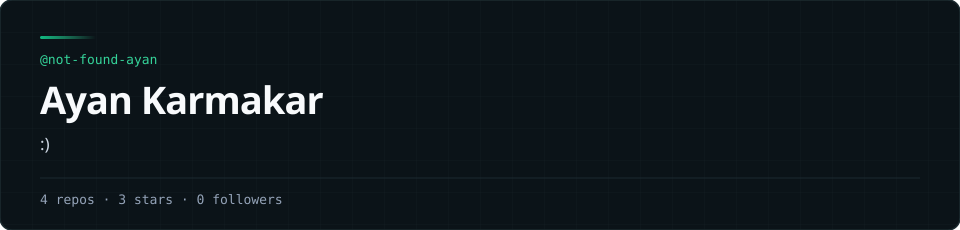

Building software in public on GitHub. :)

### Snapshot

| Public Repositories | Total Stars | Total Forks | Followers |
| ---: | ---: | ---: | ---: |
| 4 | 3 | 0 | 0 |

### About

- **Currently building:** Interactive developer tooling and open-source packages
- **Exploring:** Systems programming, performance optimization, and compilers
- **Ask me about:** Frontend architecture, TypeScript, and open-source maintenance

### Top Repositories

<!-- TOP_REPOS:START -->
| Repository | Description | Language | Stars | Updated |
| :--- | :--- | :--- | ---: | ---: |
| [**Cryptoware**](https://github.com/not-found-ayan/Cryptoware) | This is a file encrypting malware ( AKA Cryptoware ). This is just the framework, feel free to tweek things! | Python | 1 | 5mo ago |
| [**Kali-Assistant**](https://github.com/not-found-ayan/Kali-Assistant) | Get help about execution of any application command! | Python | 1 | 5mo ago |
| [**Lumverse**](https://github.com/not-found-ayan/Lumverse) | Trylumn.xyz and Verci.xyz for Linux (and much better). | TypeScript | 1 | Yesterday |
| [**not-found-ayan**](https://github.com/not-found-ayan/not-found-ayan) | — | — | 0 | Today |
<!-- TOP_REPOS:END -->

### Primary Languages

- **Python** — 66.7% (2 repos, 2 stars)
- **TypeScript** — 33.3% (1 repo, 1 stars)

### Connect

[GitHub](https://github.com/not-found-ayan) · [Website](https://bureauofvisualcontainment.netlify.app/)
